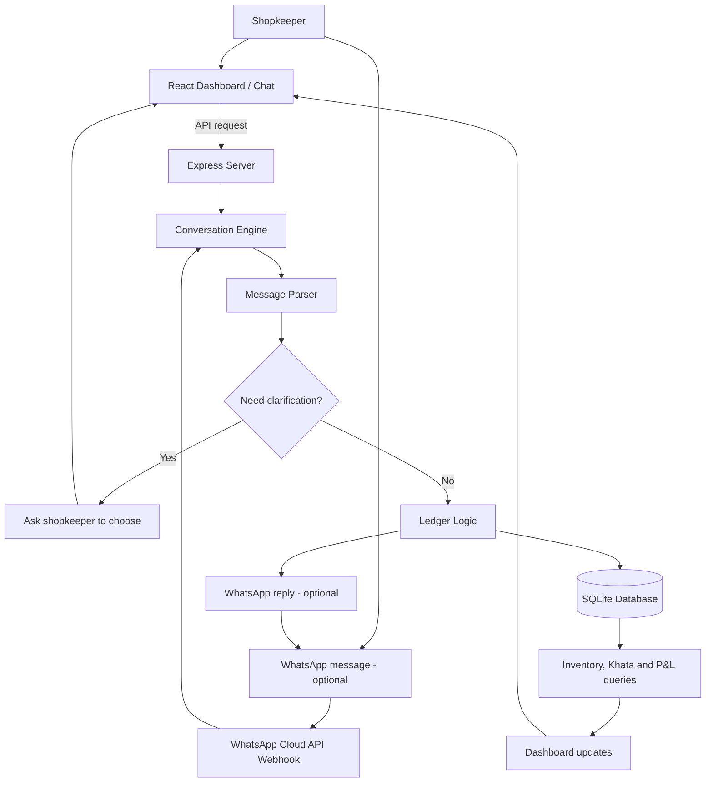

# Angadi — Smart Kirana Khata & Profit Ledger

**Built by Aura Farmers**

Small shops handle a lot every day. Stock comes in, things get sold, customers buy on credit, and somehow the shopkeeper has to keep track of all of it. It's easy for things to get confusing when everything is recorded manually.

**Angadi is our attempt to make that a little simpler.**

It's a kirana store management app where shopkeepers can keep track of their stock, record everyday transactions using simple chat messages, manage customer udhar, and get a clearer picture of their profit.

## Live Demo

🔗 **Demo:** [Add demo link here]

## What can you do with Angadi?

- **Chat-based stock updates** — Record sales, incoming stock, damaged items, and returns using everyday messages instead of filling out forms for every transaction.
- **Inventory tracking** — See available stock, spot low-stock products, and identify high-demand items based on recorded sales.
- **Customer Khata** — Keep track of who owes money, record credit given to customers, and update payments received.
- **Profit & Loss** — View daily or monthly summaries of sales, product costs, and losses from damaged stock.
- **Undo the last update** — Made a mistake while recording a transaction? Use `undo` to reverse the latest eligible update.
- **WhatsApp integration** — The project includes an optional WhatsApp Cloud API integration, so messages can be used to record transactions through WhatsApp after the required setup.

## A quick look at how it works

Instead of navigating through multiple forms, you can type messages like these into the chat ledger:

```text
sold 3 maggi small, 2 milk
received 20 rice bags
damaged 1 oil
returned 2 biscuits
Ramesh credit 200
Ramesh paid 100
undo
```

Angadi interprets the message and updates the relevant records. When a product name matches multiple items, it can ask you to select the right one before proceeding.

The dashboard brings the main information together, so you don't have to keep checking separate records for stock, customer dues, and business performance.

## Architecture / Flowchart

This is the basic flow from a shopkeeper's message to the records shown in the dashboard. WhatsApp is optional; the local dashboard can be used on its own.



## Tech Stack

We used the following technologies to build the project:

| Part | Technology |
|---|---|
| Frontend | React, Vite |
| Backend | Node.js, Express |
| Database | SQLite with `better-sqlite3` |
| Messaging integration | WhatsApp Cloud API |
| Deployment configuration | Render |

## Running it locally

You'll need **Node.js 20.19 or newer and npm**.

### 1. Clone the repository

```bash
git clone https://github.com/akicha22/Kirana-Aura-Farmers.git
cd Kirana-Aura-Farmers
```

### 2. Install dependencies

On Windows PowerShell, run:

```powershell
npm.cmd run setup
```

On other terminals, you can use:

```bash
npm run setup
```

### 3. Start the application

On Windows PowerShell:

```powershell
npm.cmd start
```

On other terminals:

```bash
npm start
```

This builds the frontend and starts the server. Open **http://localhost:3000** in your browser.

You can also check the backend health endpoint at:

http://localhost:3000/api/health

The app starts with sample products for demonstration. Stock changes are stored in a local SQLite database, so they persist between restarts.

### Running the tests

On Windows PowerShell:

```powershell
npm.cmd test
```

Elsewhere:

```bash
npm test
```

## WhatsApp setup

WhatsApp integration is optional. The dashboard and its local ledger can be used without WhatsApp credentials.

To connect WhatsApp, you'll need a Meta WhatsApp Cloud API setup, the relevant credentials, and a publicly reachable webhook URL. The project includes an `.env.example` file to help you configure the required environment variables.

**Keep your access tokens and app secrets private. Never commit your real `.env` file to GitHub.**

## Project structure

Here's a quick overview of the codebase:

```text
Kirana-Aura-Farmers/
├── client/          # React frontend and dashboard
├── src/
│   ├── server.js    # Express server and API routes
│   ├── parser.js    # Understands chat commands
│   ├── engine.js    # Handles conversation flow
│   ├── ledger.js    # Stock, Khata and P&L logic
│   ├── db.js        # SQLite database and sample data
│   └── whatsapp.js  # WhatsApp webhook integration
├── test/            # Automated backend tests
├── .env.example     # Environment variable template
├── package.json
└── README.md
```

## A note on the project

Angadi is built around a simple idea: managing a small shop shouldn't require shopkeepers to juggle multiple complicated records just to understand what's happening in their business.

The aim is to make everyday entries easier, keep important information in one place, and help local shop owners make more informed decisions.

The profit figures depend on the costs and transactions recorded in the system. They are useful summaries, not a complete accounting statement covering every business expense.

---

**Built with care by Aura Farmers.**
